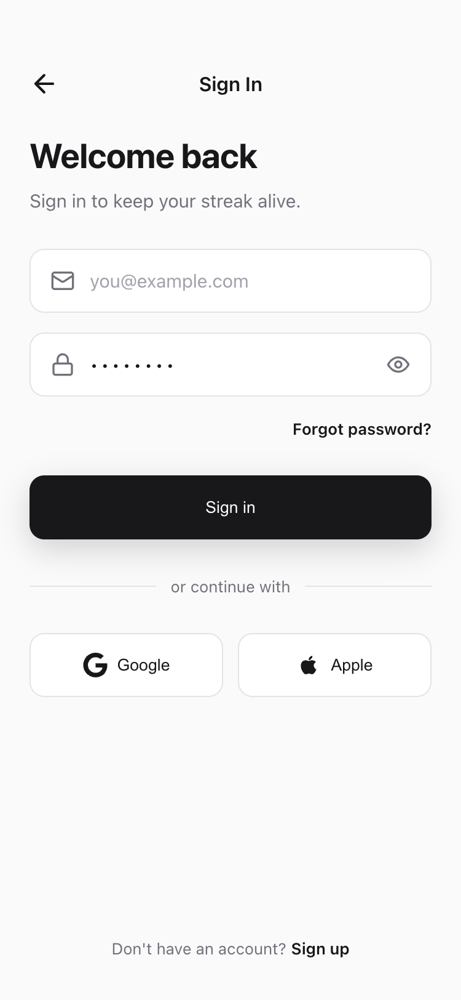

# figma-xml-to-ui

An Agent Skill that turns exported Figma XML (such as **FigML**) into **1:1 UI code** for **React Native**, **React.js**, **Vite.js**, **Next.js**, and **SwiftUI** — with design-token discovery, icon mapping, and reuse of components you already have.

Built for Figma **Free / Starter** plans: no Dev Mode seat, no MCP rate limits, just an XML export and your agent.

> Maintained by **hamzhya** · repository: [`ajihairi/figma-xml-to-ui`](https://github.com/ajihairi/figma-xml-to-ui). The install command uses the GitHub owner path; `hamzhya` and `ajihairi` are the same maintainer.

---

## What it does

- **1:1 layout and visuals.** Preserves auto-layout direction, padding, gaps, `FIXED` / `HUG` / `FILL` sizing, typography, radii, hex colors, shadows, strokes with their `strokeAlign`, gradients, image fills, and rotation.
- **Platform routing.** Detects your stack and loads only the matching rulebook, so RN rules never leak into SwiftUI output.
- **Real FigML schema.** Handles the actual export shape: `<children>` wrappers, paints as `<fills>` / `<strokes>`, effects as `<effects>`, component names as element tags, `characters` for text.
- **Hidden and undefined nodes.** Skips `visible="false"` layers and component masters, and leaves a `TODO(figma)` instead of inventing an asset or a value.
- **Token discovery.** Scans `tailwind.config.*`, `globals.css`, `theme.ts`, `tokens.ts`, or Swift `Assets.xcassets` and maps values only on exact matches.
- **Component and icon reuse.** Maps XML instances to your existing components, and vector nodes to `lucide-react` / `lucide-react-native` / SF Symbols.
- **Per-project overrides.** An optional `.opencode/figma-map.md` maps Figma layer names to your codebase.

---

## Install

### One command

```bash
npx skills add ajihairi/figma-xml-to-ui
```

### Manual

Copy the skill folder into your agent's global skills directory.

**OpenCode**

```bash
mkdir -p ~/.config/opencode/skills
cp -r skills/figma-xml-to-ui ~/.config/opencode/skills/figma-xml-to-ui
```

**Claude Code**

```bash
mkdir -p ~/.claude/skills
cp -r skills/figma-xml-to-ui ~/.claude/skills/figma-xml-to-ui
```

**Cursor / Windsurf / Codex** — point the tool at `skills/figma-xml-to-ui/SKILL.md`, or copy it into the tool's own skills/rules directory.

---

## Usage

### 1. Export XML from Figma

1. Install [FigML — Figma XML Exporter](https://www.figma.com/community/plugin/1515328157096190551/figml-figma-xml-exporter-plugin) (free).
2. In the plugin settings, leave **Use HEX color format** and **Omit default values** on; that is what the skill expects. Turn **Simplify vector paths** off only if you need exact custom vectors.
3. Select the frame or component, run **Plugins → FigML**, and save the XML inside your project, e.g. `specs/login-screen.xml`.
4. For complex screens, export sections or components one at a time — FigML's own guidance, and it keeps the tree readable.

### 2. Optional project overrides

```bash
mkdir -p .opencode
cp skills/figma-xml-to-ui/assets/figma-map.template.md .opencode/figma-map.md
```

Edit `.opencode/figma-map.md` to declare your components, tokens, and icon library. Rules there outrank the skill's heuristics.

### 3. Generate

```text
Use figma-xml-to-ui to convert @specs/login-screen.xml into src/screens/LoginScreen.tsx with 1:1 fidelity.
```

The agent reads the platform rulebook, discovers your tokens and components, translates the full node tree, and runs a parity check before reporting done.

---

## Try it with the bundled example

`examples/sample-login.xml` is a real-schema FigML export of a 375 × 812 login screen — nav bar, header, two inputs, primary CTA, divider, social buttons, and footer. It doubles as a smoke test: the file's header comment lists the nine expected visual results.

`examples/sample-card.xml` is the coverage fixture: image fills without bundled bitmaps, a linear gradient scrim, an inner shadow, a `visible="false"` badge, rotation, and absolute positioning. Run the skill against both before trusting a release.

```text
Use figma-xml-to-ui to convert @examples/sample-login.xml into a single LoginScreen component. Match the 9-point checklist in the file header exactly.
```

**Reference render** — open at 100% and compare side by side with the generated screen:



`examples/preview.html` is the hand-checked 1:1 render of the XML, exported as `preview.png` at 375 × 812 (2×). Compare boxes, spacing, and colors against it. The preview uses the system UI font stack rather than bundling Inter, so glyph widths can differ slightly in your app — boxes and spacing should not. Regenerate with `bash scripts/preview.sh`.

---

## Repository layout

```text
figma-xml-to-ui/
├── skills/
│   └── figma-xml-to-ui/
│       ├── SKILL.md                  # 6-step pipeline + platform router
│       ├── references/
│       │   ├── figml-format.md       # actual FigML schema, paints, unknown-node policy
│       │   ├── react-native.md       # RN primitives, Flexbox, NativeWind, shadows
│       │   ├── web-react.md          # React / Vite / Next, Tailwind, semantic HTML
│       │   └── swiftui.md            # HStack/VStack/ZStack, modifier order, SF Symbols
│       └── assets/
│           └── figma-map.template.md # starter .opencode/figma-map.md
├── examples/
│   ├── sample-login.xml              # real-schema end-to-end fixture
│   ├── sample-card.xml               # image / gradient / hidden / rotation fixture
│   ├── preview.html                  # 1:1 reference render of sample-login
│   └── preview.png                   # 750 × 1624 screenshot of preview.html
├── scripts/
│   ├── preview.sh                    # regenerate preview.png
│   ├── check-skill.py                # frontmatter + reference integrity
│   └── check-examples.py             # schema, geometry, preview coverage
├── .github/workflows/validate.yml    # CI: xmllint + both scripts
├── docs/
│   └── publishing.md                 # topics, install check, preview regen
├── LICENSE
└── README.md
```

`SKILL.md` is loaded up front and points at `references/figml-format.md` plus one platform reference; the rest loads only when needed.

---

## Verify before sharing

```bash
npx skills add ajihairi/figma-xml-to-ui --list
python3 scripts/check-skill.py
python3 scripts/check-examples.py
bash scripts/preview.sh
```

CI runs the last three (minus the browser) on every push: `.github/workflows/validate.yml`. Full checklist, including topics and skills.sh indexing: [`docs/publishing.md`](docs/publishing.md).

---

## License

MIT — see [LICENSE](LICENSE).
